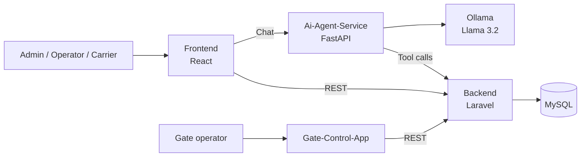
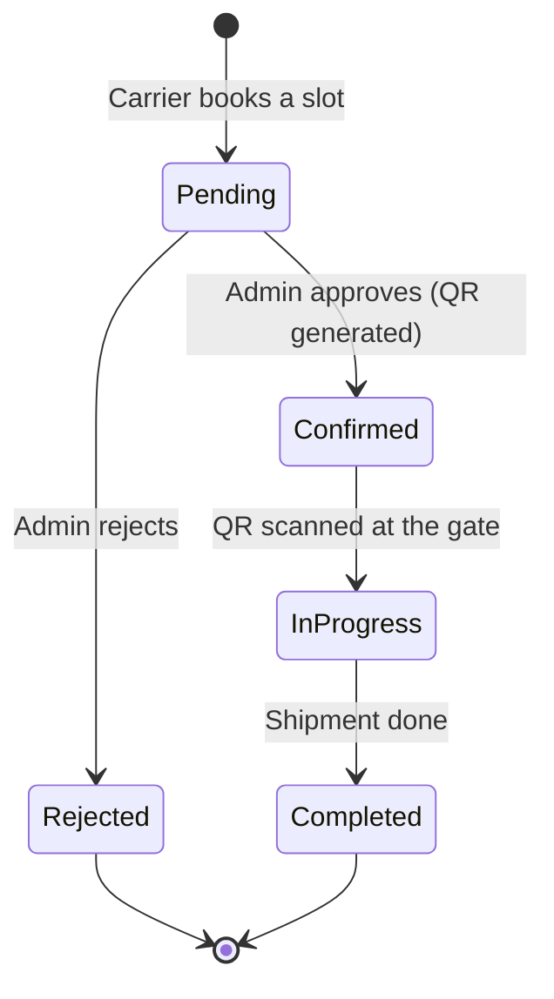

# ⚓ APCS — Algerian Port Community System

**AI-powered port terminal management — smart booking, QR-based gate access and real-time capacity monitoring.**

Built at **MicroHack 2026**, organized by **Micro Club** and **Algerian Port Community System**. The challenge: a truck booking management system with an intelligent logistics assistant to regulate port access, manage terminal capacity and answer booking questions in natural language.

## 🧩 The Problem

Port terminals still rely on manual booking, phone calls and paper checks at the gate. The result: trucks queuing for hours, terminals that are overbooked one hour and empty the next, and no real-time view of what is happening.

## 💡 Our Solution

APCS digitizes the whole flow of a truck through the terminal:

- **Smart booking** — carriers book a timeslot, with live capacity per hour
- **QR gate access** — each confirmed booking gets a one-time QR code, scanned at the gate
- **Late arrival handling** — a late truck is moved to a late-capacity slot or automatically rescheduled
- **AI assistant** — ask in natural language: *"What are my bookings this week?"* — the agent calls backend tools to answer with real data
- **Role-based dashboards** — Admin, Operator and Carrier each get their own view
- **Incidents & audit log** — issues are tracked and every action is logged

## 🏗️ Repositories

| Repository | Role | Stack |
|------------|------|-------|
| [Frontend](https://github.com/APCSLogistique/Frontend) | Web app with role-based dashboards (admin, operator, carrier) | React 19, Vite, Tailwind CSS 4, Recharts |
| [Backend](https://github.com/APCSLogistique/Backend) | Core REST API — auth, bookings, timeslots, QR codes, incidents | Laravel 12, MySQL, JWT, Docker |
| [Gate-Control-App](https://github.com/APCSLogistique/Gate-Control-App) | Gate-side app for scanning QR codes and processing truck entries | JavaScript |
| [Ai-Agent-Service](https://github.com/APCSLogistique/Ai-Agent-Service) | AI assistant with tool calling over the backend API | Python, FastAPI, Ollama (Llama 3.2) |

## 🖇️ Architecture

## 🔄 Booking Lifecycle

## 👥 Team

- **Adel Merad** — [GitHub](https://github.com/adelmerad) · [LinkedIn](https://www.linkedin.com/in/adel-merad-57b5a4301/)
- **Wail Mansour Ouahchia** — [GitHub](https://github.com/wailman24)
- **Amine Ouattas** — [GitHub](https://github.com/SonerAmine)
- **Abderrahmane Barkou** — [GitHub](https://github.com/Imaaann)
- **Mohamed Amine Baziz**

---

Built with ❤️ at MicroHack 2026 — Laravel · React · Python

